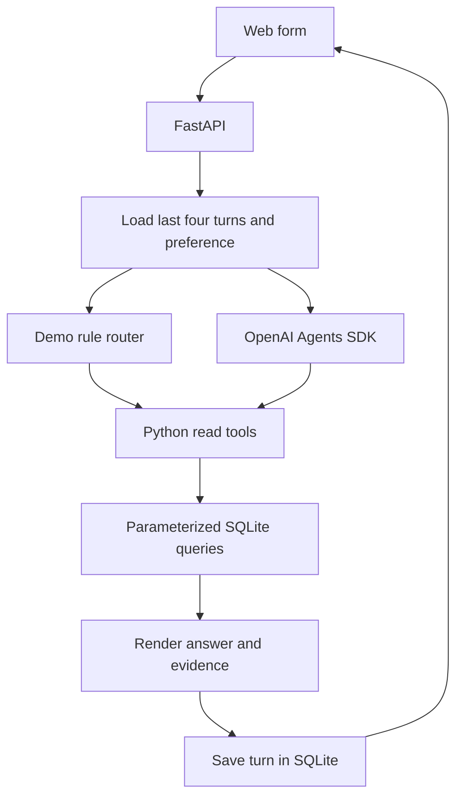

# AI Event Operations Agent

This portfolio project grew out of my work on an event analytics platform at TruAbutment. I wanted to explore how an agent could use registration counts and deadlines to help an event coordinator decide what needs attention. All events, registrations, and deadlines in this demo are synthetic.

A local, single-operator workbench for four fictional events. Ask about confirmed registrations, open deadlines and operational priorities. Expand the evidence beneath each answer to see the selected tool and its returned records. All data represents **November 19, 2026**. The clock stays fixed so the examples and evaluations are reproducible.

## Run the free demo

From the extracted project folder, with Python 3.12:

```bash
python -m venv .venv
source .venv/bin/activate
python -m pip install -r requirements.txt
python -m uvicorn eventops.web:app --host 127.0.0.1 --port 8000
```

On Windows PowerShell, activate with `.\.venv\Scripts\Activate.ps1`. Open http://127.0.0.1:8000. The first launch seeds a local SQLite file with 224 confirmed and nine cancelled registration records. Reopening retains your history and preferences. EVENTOPS_DB selects a different database path.

## Five-minute walkthrough

1. Ask **Show Systems Summit performance**. You should see 84 confirmed against 120, 70% attainment, and a gap of 36.
2. Ask **What is its deadline?** in the same tab. The stored event reference resolves to Systems Summit. Its catering guarantee is due November 21.
3. Ask **Rank operational risks**. Sensor Lab ranks first because its shipment deadline passed yesterday even though registration is full. Systems Summit ranks second because the catering guarantee is due within two days.
4. Ask **Remember a 3-day deadline window** and then **Show deadlines**. Sensor Lab and Systems Summit appear. Edge Expo's deposit, six days away, falls outside your preference. A new session keeps the preference while starting fresh conversational context.

## Architecture



* **eventops/store.py** owns the schema, idempotent synthetic seed and memory. Session history is the last four turns loaded for one tab. Persistent memory is the operator's explicitly saved deadline window, shared across tabs. Retrieval reads current event records on every question. A remembered answer never becomes the source of a registration count.
* **eventops/tools.py** defines metric semantics. Confirmed rows count toward the target. Gap is max(target minus confirmed, zero). Rank overdue open work first, tasks due within two days second, remaining registration shortfalls third, and other events fourth. Larger gaps break ties. The risk list considers all open tasks regardless of the display window. This is a transparent triage policy, not a forecast.
* **eventops/agent.py** coordinates planning, context and rendering. Demo mode recognizes a limited vocabulary and supports one intent per turn. Use the example question patterns. Unfamiliar phrasing can yield clarification or an overly broad match.
* **eventops/live.py** registers three typed SDK functions. A model receives the question and bounded context and chooses a function and event ID. The SDK dispatches that call. Python renders the returned evidence directly. This bounds numerical errors and keeps arbitrary SQL and external write actions outside the model's capabilities. A wrong event or tool choice can still produce an irrelevant answer.
* **eventops/web.py** validates the HTTP input and returns a recoverable 503 on failures. The browser shows mode, tool and evidence. Preferences are local writes triggered by the explicit remember command.

## First model request and live agent

Demo mode requires no API key. To authorize live spending yourself, configure OPENAI_API_KEY in your shell or secret manager. Keep it out of source control. The following commands are optional. Each model request can incur charges.

```bash
export EVENTOPS_ALLOW_PAID=yes
export OPENAI_MODEL=gpt-4.1-mini
python -m eventops.first_request
EVENTOPS_MODE=live python -m uvicorn eventops.web:app --host 127.0.0.1
```

The first script sends one instruction through the Responses API and prints output_text. The live agent extends that model request with function schemas. Compare an identical prompt across demo and live runs using the visible evidence. In live mode, question text and the last four turns are included in model input. Use synthetic questions. Stop the server and restart in default demo mode to resume free operation.

## Reproduce the evaluation

```bash
python -m pytest -q
python evaluate.py
```

The 31 JSON cases check route, event scope, and selected evidence or abstention. The evaluator uses a fresh temporary database, one HTTP request per case, and reports accuracy, median and p95 latency and error rate. Additional Pytest cases cover follow-ups, persistent preferences, a failed tool, restricted queries, duplicate seeding, UI entry point, request validation and real SDK dispatch with a simulated model response. See docs/evaluation.json for measured results. These curated cases are a regression suite. Broader paraphrases and held-out questions are needed to establish generalization.

The same evaluator can measure actual model behavior with EVENTOPS_MODE=live and explicit paid opt-in. Running it then sends multiple paid requests. The supplied results are offline only. No hosted deployment, authentication, BigQuery connection, or measured live-model accuracy is included. The operator and their sessions share a single local database; keep the service bound to localhost.

## Portfolio and interview notes

* Built a local FastAPI event operations agent with three typed analytics tools, SQLite-backed conversation context, and evidence-backed registration and deadline triage.
* Developed a 31-case evaluation set and 37 automated tests, including simulated model dispatch through the OpenAI Agents SDK, tool failure recovery, and access restriction checks.

**Why is this more than a dashboard?** A follow-up can refer to the previous event and use an explicitly saved preference. The agent maps that context to a constrained data operation and shows the result.

**How does this connect to reliability engineering?** The key failure modes are counting cancelled registrations, acting on the wrong event, and answering after a failed query. Demonstrate the corresponding fixture, scope check, and 503 test. A legitimate query against the wrong event remains a failure, which is why evaluation scores both route and event ID.

**How would you extend it?** Replace the event retrieval query with a read-only BigQuery adapter while keeping the tool result contracts. For multiple operators, introduce authenticated ownership of sessions and preferences. Before making live accuracy claims, run a separately labeled held-out evaluation against the chosen model.
